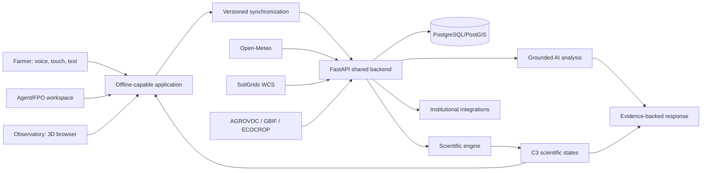
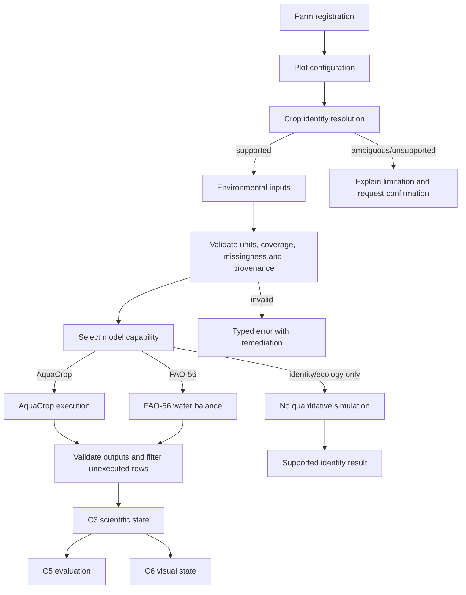
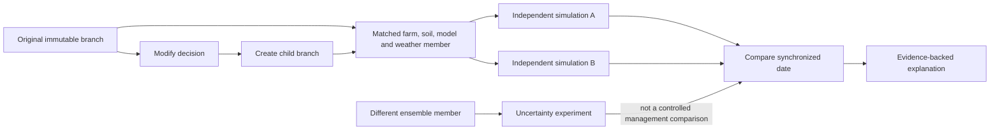
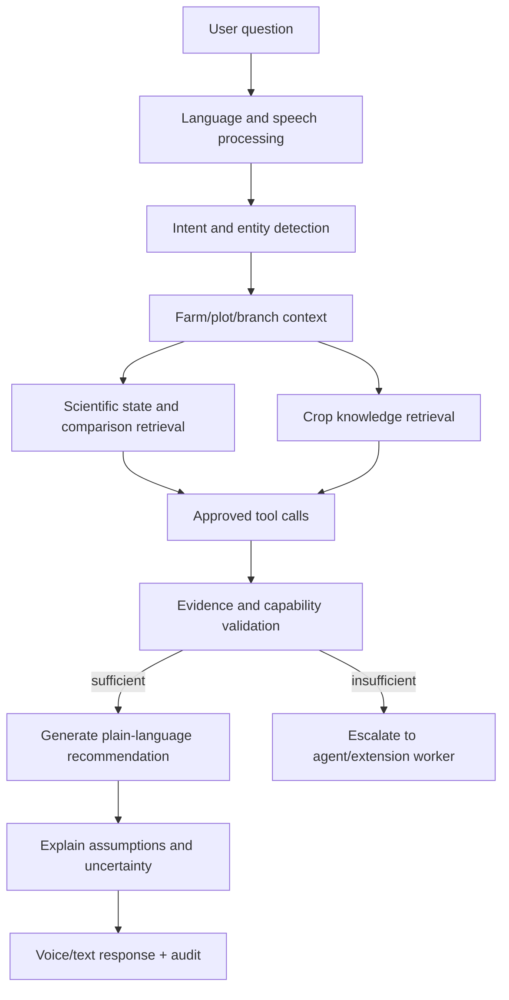
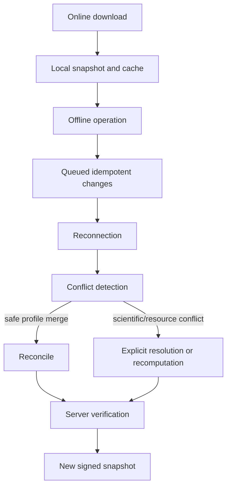
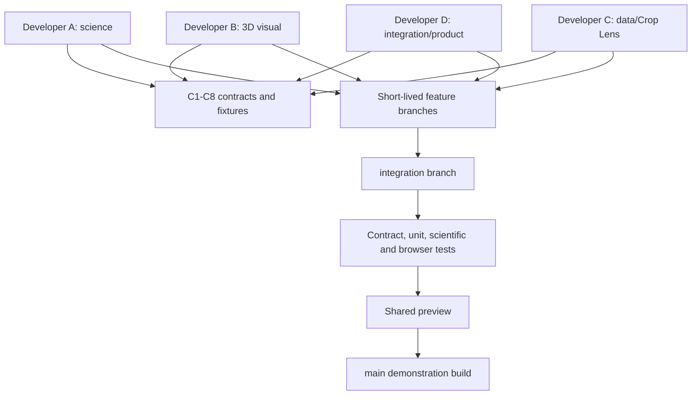

# TerraPulse 2.0 Implementation Blueprint

**Team:** Kalakand  
**Event:** Colossus 3.0, November 13–14, 2026  
**Version:** 2.0 implementation baseline  
**Product principle:** The farmer should never have to adapt to TerraPulse. TerraPulse adapts to the farmer.

> **Evidence labels used in this document**
> - **Verified:** supported by the supplied handoff, technical investigations, or a cited primary source.
> - **Estimate:** an explicit planning assumption, not a market fact.
> - **Hypothesis:** requires field or buyer validation.
> - **Prototype:** acceptable for the competition only when labelled and not presented as a validated production capability.

## 1. Executive summary

TerraPulse remains an immersive agricultural decision laboratory. Its defensible product is not a chatbot, marketplace, disease detector, weather screen, or ordinary farm dashboard. It is a farmer-accessible decision loop:

**farm information → scientifically supported simulation → matched alternative futures → plain-language explanation → practical next action.**

The three non-negotiable pillars are:

1. **Simulation:** one authoritative scientific engine per plot and branch, using AquaCrop-OSPy 3.1.0 where appropriately parameterized and FAO-56 water-balance pathways where validated.
2. **Future Fold:** two independently simulated branches with identical controlled inputs and matched weather realizations when comparing management decisions.
3. **AI Analysis:** evidence-grounded interpretation of model outputs, environmental data, provenance, uncertainty and assumptions. AI never invents unsupported yield, disease, weather or financial predictions.

The product has one shared farm and scientific state system with adaptive interfaces:

- **TerraPulse Connect:** lightweight, touch, text, voice and local-language farmer access.
- **TerraPulse Observatory:** the existing Living Field, Farm Timeline and Future Fold 3D experience for advanced users, field agents, FPOs, demonstrations and planning.
- **Assisted access:** field workers, FPOs, KVKs and extension staff can onboard farmers and explain results.

The initial commercial wedge is **FPO-supported irrigation and crop-risk planning**, with farmer access funded by institutions. Individual subscriptions, insurer/lender workflows, buyer intelligence and research APIs remain hypotheses until pilots demonstrate willingness to pay and safe impact.

The two-day competition target is a complete, demonstrable journey:

**locate a field → select turmeric or another supported crop → obtain provenance-labelled environmental inputs → run a supported simulation → explore the Living Field → change planting or irrigation → compare Future Fold branches → receive a grounded action explanation → reopen cached results offline.**

## 2. Original project assessment

### What must be preserved

The supplied project already has a coherent architecture and prior feasibility evidence:

- React + TypeScript, Three.js, React Three Fiber and Drei.
- Python scientific backend.
- AquaCrop-OSPy 3.1.0 and FAO-56.
- Open-Meteo weather and ensemble information.
- SoilGrids WCS soil properties.
- FAO AGROVOC, GBIF and ECOCROP crop intelligence.
- C1–C8 semantic contracts.
- Living Field, Farm Timeline, Future Fold, Crop Lens, multicrop management and shared-water accounting.
- Cloud-hosted full-stack deployment with verified local fallback.

Do not revert to a Canvas 2D prototype, a single-field calculator, a decorative 3D scene, or an AI-only product.

### The core weakness to correct

An impressive 3D environment is not automatically useful to a farmer. Farmers may have limited literacy, shared or inexpensive Android phones, intermittent connectivity, regional-language preferences and trusted relationships with FPOs or extension workers. The original system should therefore be **reframed, not replaced**:

- Put simple decisions and actions before model terminology.
- Make the Observatory optional for low-end devices.
- Make offline farm records and cached, clearly dated results first-class.
- Deliver explanations through voice, icons and short local-language messages.
- Keep the scientific engine authoritative beneath every interface.

### Scorecard interpretation

The supplied round-one scorecard image shows Team Kalakand among the stronger entries, with an overall score of **73/100**. The visible components are approximately:

| Dimension | Score | Interpretation |
|---|---:|---|
| Impact | 15/20 | Strong social and agricultural relevance; show a concrete farmer action and measurable outcome. |
| Creativity | 19/25 | Future Fold and immersive simulation are memorable; retain the visual differentiator. |
| Design | 19/25 | Strong concept and visual direction; reduce cognitive load and expose accessible modes. |
| Execution | 20/30 | Feasibility and full-stack proof matter; demonstrate one integrated path rather than claims about every feature. |

The strategic response is not to add unrelated features. It is to make the existing simulation visibly solve a farmer decision and make that decision understandable without requiring a technical user.

## 3. Market research and opportunity

### 3.1 Verified problem framing

The supplied market analysis and project research establish these product constraints:

- Sowing, irrigation, weather uncertainty, crop health, input costs and market access are interconnected decisions.
- Connectivity, language, literacy and device performance affect adoption.
- SoilGrids is modelled soil information, not a live field-moisture measurement.
- Open-Meteo ensemble members are individual plausible trajectories, not a single deterministic future.
- Missing, invalid and genuine zero values must remain distinct.
- Broad counts of farms, farmers or FPOs are not paying-customer counts.

The research sources below should be refreshed before external publication. The document deliberately avoids presenting an unverified agritech TAM as fact.

### 3.2 Farmer problems TerraPulse can address

| Problem | Decision consequence | TerraPulse fit | Evidence status |
|---|---|---|---|
| Uncertainty about planting date | Poor establishment or avoidable water stress | Compare planting-date branches under matched weather | Existing validated direction |
| Limited irrigation | Crops compete for one resource | Shared-water ledger and plot-level trade-offs | Existing contract; validate in implementation |
| Seasonal weather uncertainty | One forecast hides risk range | Preserve and compare ensemble members | Existing technical investigation |
| Complex agronomy | Advice is difficult to interpret | Grounded explanation of model states and assumptions | Product design hypothesis |
| Low connectivity | Guidance unavailable in the field | Cached profiles, results and validated local calculations | Architecture requirement |
| Off-catalogue crops | Fixed lists exclude real farms | Crop Lens resolves names and selects capability pathway | Existing acceptance scenario |

TerraPulse should not claim to solve live disease diagnosis, market-price prediction, insurance underwriting or yield improvement until separately validated.

### 3.3 Segments and buyers

| Segment | Need | Role |
|---|---|---|
| Small and marginal farmers | Simple, timely, trusted decisions | Primary beneficiary |
| Digitally connected farmers | Richer planning and scenario comparison | Possible premium user |
| FPOs and cooperatives | Member planning, water coordination and field support | Initial buyer |
| KVKs, extension workers and NGOs | Explainable assisted advisory | Distribution and validation partner |
| Insurers and lenders | Governed risk evidence, not automated exclusion | Future buyer |
| Processors and buyers | Production planning and aggregate uncertainty | Future buyer |
| Agricultural researchers | Reproducible scenarios and field feedback | Research partner |

### 3.4 Competitor analysis

Capabilities below distinguish public positioning from TerraPulse-specific claims. Product details must be rechecked against dated primary documentation before a judge- or investor-facing publication.

| Competitor | Target/customer | Main delivery and strengths | Offline/voice/science observations | TerraPulse response |
|---|---|---|---|---|
| DeHaat | Indian farmers and agricultural commerce | Advisory, inputs and market-linked services | Strong distribution proposition; do not assume its modelling or offline scope | Do not compete as a marketplace; add reproducible decision alternatives |
| Cropin | Enterprises, governments and large programmes | Farm intelligence, analytics and enterprise workflows | Institutional strength; public claims require verification | Offer a transparent plot/branch scientific layer where validated |
| Fasal | Precision farming and irrigation users | Sensors, irrigation and field intelligence | Hardware/service dependency may not fit every smallholder | Provide a low-cost model-based planning path and shared-water reasoning |
| Plantix | Farmers seeking crop issue help | Image-based crop issue identification and advice | Useful triage category; not a substitute for water/planting simulation | Keep image triage future/secondary and never call it definitive diagnosis |
| Digital Green / FarmerChat | Smallholders and extension ecosystems | Accessible farmer advisory and local-language distribution | Voice and assisted reach are valuable; voice alone is not a moat | Integrate accessible delivery with model-backed counterfactuals |
| Kisan Sarathi | Institutional farmer advisory | Government-supported advisory access | Partnership opportunity rather than duplication | Supply explainable simulation outputs through assisted channels |
| Gramophone | Farmers and agricultural commerce | Advisory, inputs and transactions | Commerce and distribution strengths | Avoid a generic commerce product |
| FAO/ICAR and research tools | Researchers, extension and programmes | Authoritative knowledge and models | Often not a simple farmer decision interface | Translate validated outputs without weakening scientific provenance |

**Gap hypothesis:** Existing services often provide advice, transactions, monitoring or a single prediction. TerraPulse can test whether farmers and FPOs value an **evidence-traceable decision-to-action loop** that compares “same farm, same weather, different decision” and explains the trade-off in a local-language interaction. This is a hypothesis, not a proven monopoly.

### 3.5 Commercial hypotheses

Illustrative pricing is for interviews only:

| Stream | Buyer | Value | Exploratory approach | Difficulty/risk |
|---|---|---|---|---|
| FPO subscription | FPO/cooperative | Member onboarding, scenario planning and water coordination | ₹15,000–₹60,000/year pilot range | Prove retention and field-worker time saved |
| Institutional programme | NGO, government or research programme | Sponsored farmer access and impact evaluation | Project procurement | Long sales cycles and evidence burden |
| Enterprise intelligence | Insurer, lender or processor | Aggregate, consented and governed scenario evidence | ₹2L–₹15L/year exploratory range | Never let a score autonomously determine credit or insurance |
| Premium planning | Digitally capable farmer | Rich Observatory and saved scenarios | ₹299–₹999/year test only | Smallholder willingness to pay is unvalidated |
| Research partnership | University/ICAR/researcher | Reproducible scenarios, provenance and field feedback | Grant or service contract | Data rights and model licensing |

Do not sell identifiable farm data. Sponsored recommendations must not silently bias agronomic outputs.

### 3.6 Validation plan

Before scaling:

1. Interview 30 farmers across farm sizes, crops, device access and language.
2. Interview 5 FPOs, 3 extension experts, 3 risk/finance stakeholders and 3 buyers.
3. Observe real sowing, irrigation and selling decisions.
4. Compare voice and text task completion.
5. Run offline field tests.
6. Have agronomists review model explanations.
7. Measure comprehension, action taken, false-positive alerts, calibration and consent compliance.
8. Seek paid pilot intent before building enterprise modules.

## 4. Product definition

### Vision and mission

**Vision:** Every farmer can understand the consequences of a farm decision before committing scarce land, water or money.

**Mission:** Make scientifically defensible agricultural simulation accessible through the farmer’s language, device, connectivity and trusted support network.

### Unique value proposition

> **Same farm. Same weather. Different decisions. Understand the trade-offs before acting.**

TerraPulse combines authoritative crop-water simulation, reproducible alternative futures and grounded explanation in an adaptive experience. The 3D Observatory makes invisible spatial and temporal change tangible; it is not a prerequisite for basic farmer access.

### Product structure

One application and one authoritative state system expose three modes:

1. **Connect mode:** mobile-first farmer workflow with voice, icons, simple cards, cached results and explicit freshness.
2. **Assisted mode:** FPO/field-agent workflow for onboarding, explanation and consented member support.
3. **Observatory mode:** desktop/tablet Living Field, Timeline and Future Fold for exploration and demonstrations.

### Personas

- **Lakshmi, smallholder farmer:** speaks Kannada, shares an Android phone, needs a simple irrigation decision and can be offline.
- **Ravi, FPO field worker:** supports 80 members, needs repeatable explanations and conflict-safe syncing.
- **Dr. Meena, agronomist:** needs provenance, model limitations and branch assumptions.
- **Arjun, advanced farmer/student:** wants the full 3D experience and ensemble exploration.
- **Programme manager:** needs aggregate consented usage and impact reports, not hidden personal data.

### Core user journeys

1. **Onboard:** choose language → voice or touch farm location → confirm actual field → create plot → select crop by local/common/scientific name.
2. **Simulate:** accept cached or refreshed weather/soil inputs → see capability statement → run simulation → receive water/stress and supported outcome cards.
3. **Decide:** ask “What if I plant later?” or choose an irrigation change → create immutable branch → compare at the same date and weather member.
4. **Act:** AI explains what changed, confidence, assumptions and next practical action; farmer saves or shares the result.
5. **Offline:** reopen last verified result with timestamp; perform only locally supported calculations; queue decisions and sync explicitly later.

## 5. Pillar A — Simulation

### Purpose and lifecycle

Simulation turns a farm decision into a reproducible, time-indexed scientific state:

1. Register actual farm and plots (C2).
2. Resolve crop identity and capability (C7).
3. Retrieve or select soil and weather inputs (C1).
4. Validate units, coverage, dates, missingness and provenance.
5. Select exactly one authoritative engine per plot/branch.
6. Execute AquaCrop-OSPy 3.1.0 or a validated FAO-56 pathway.
7. Filter unexecuted/invalid output rows; never turn missing into zero.
8. Persist C3 states with model, parameter and input versions.
9. Evaluate only supported metrics (C5).
10. Produce C6 visual interpretation and AI evidence bundle.

### Model capability boundaries

| Pathway | May calculate | Must not claim |
|---|---|---|
| AquaCrop-supported crop | Model-supported development, root-zone water, stress, biomass/yield where parameterized and executed | Universal calibrated yield for every crop or location |
| FAO-56 water balance | ET, crop coefficient, root-zone depletion, irrigation and water-stress indicators under stated assumptions | Fully validated biological growth or harvest prediction |
| Identity/ecology-only | Crop identity, aliases, taxonomy, ecology and suitability references | Quantitative yield, biomass or growth |
| Future pathway | Explicitly versioned and validated new model | Production authority before acceptance tests |

### Inputs and outputs

Inputs: C1 environmental input, C2 farm/plot, crop parameters, management decisions, branch/weather identity and model configuration.

Outputs: C3 scientific states, C5 supported comparisons, provenance records, warnings and capability disclosures.

### Offline/online behaviour

- **Offline:** use cached validated soil/weather/parameters and locally packaged calculation pathways. Mark freshness and coverage. If a cloud job is required, show “unavailable offline” rather than a success-shaped fallback.
- **Online:** refresh inputs, run backend jobs, retrieve ensemble members and update provenance.

### Failure states

Unsupported crop; ambiguous identity; missing soil depth; invalid units; stale weather; NoData grid; engine failure; non-reproducible result; insufficient evidence. Each returns a typed error with a user-safe explanation and developer log correlation ID.

### Validation

Golden fixtures reproduce known planting-date and turmeric water-balance cases; mass-balance checks pass; unexecuted AquaCrop slots are excluded; source and parameter versions are present; unsupported quantities are absent/null with status, never zero-filled.

## 6. Pillar B — Future Fold

Future Fold is a comparison of **independent simulations**, not a visual toggle.

### Branch rules

- A branch has immutable ID, parent ID, creation event, effective decisions, input hashes, model versions and weather-member identity.
- Rewind reads a prior immutable state and creates a new child branch; it never mutates prior history.
- Management comparisons use identical farm definition, soil, simulation period, model version and matched weather member.
- Environmental uncertainty experiments intentionally vary weather-member identity and label that difference.
- Every branch has its own resource ledger. A counterfactual branch does not consume the real branch’s reservoir.
- Comparison timestamps are synchronized absolute simulation dates; visual interpolation never changes numerical state.

### Comparison outputs

Compare only supported metrics:

- crop-water stress/protection;
- total gross withdrawal and effective root-zone irrigation;
- drainage, reserve use and water efficiency;
- growth/biomass/yield only when the selected model supports them;
- assumptions, changed inputs and provenance.

The provisional water-decision score is:

`0.60 × crop protection + 0.25 × water efficiency + 0.15 × reserve safety`

It is a decision score requiring validation, not a universal crop-quality or yield score.

### User experience

The farmer changes one decision, names the “what-if”, sees two synchronized views or a simple card comparison, and hears/reads: what changed, why it changed, what is uncertain, and what action is available.

### Failure states and acceptance

Reject branch creation when required inputs are missing; disallow mismatched weather in a controlled comparison; show “not comparable” for different model capabilities; verify replay hash equality; camera and timeline remain synchronized across both views.

## 7. Pillar C — AI Analysis

### Responsibilities

AI may:

- classify user intent and language;
- retrieve farm, plot, branch, C3 state, C5 comparison and C7 capability evidence;
- call approved tools for calculations or retrieval;
- summarize observed/modelled conditions;
- explain uncertainty and assumptions;
- translate and generate voice/text responses;
- suggest actions that are traceable to evidence;
- escalate to an FPO/extension worker when evidence is insufficient.

AI may not:

- invent a numerical state, yield, price, disease diagnosis or forecast;
- override the scientific engine;
- silently use stale weather as current;
- hide a limitation or confidence level;
- recommend a sponsored action as if it were neutral science;
- make autonomous insurance, credit or eligibility decisions.

### Architecture

1. Input language detection and speech-to-text.
2. Intent and entity extraction.
3. Consent and role check.
4. Farm/plot/branch retrieval.
5. Scientific result and provenance retrieval.
6. Crop knowledge retrieval from approved references.
7. Tool calls for comparison, unit conversion or freshness checks.
8. Evidence validator: every numerical claim maps to a field and source.
9. Response planner with confidence and “known/assumed/unavailable”.
10. Local-language text-to-speech or text response.
11. Audit record and optional human escalation.

### Online and offline

- Online: cloud LLM is optional, RAG can use current indexed references, and a backend policy layer validates tool calls.
- Offline: deterministic templates, local knowledge packs, cached states and a small on-device speech/NLU model may answer bounded intents. No network-dependent live weather, prices, remote expert or cloud LLM claim is made offline.

### AI acceptance

For each response, automated tests verify cited evidence IDs, no unsupported metric appears, stale data is labelled, assumptions are exposed, and unsupported questions receive an explicit limitation/escalation response.

## 8. Offline-first and remote access architecture

### Technology decision

Use a responsive React PWA with Service Worker caching and IndexedDB for the shared web client. Add a thin Android/Capacitor shell only if field testing proves PWA limitations; do not fork the product. A native SQLite layer is appropriate for a future Android package, but is not required for the competition path.

Use:

- IndexedDB via a typed repository layer;
- versioned append-only operation queue;
- content-addressed snapshots for scientific results;
- background sync when available;
- explicit “last synced”, “expires”, “source” and “offline” indicators;
- server-side idempotency keys and optimistic concurrency versions.

### Feature matrix

| Feature | Online | Low connectivity | Fully offline |
|---|---|---|---|
| Farm profile | Create/update and sync | Local edits queued | View/edit local profile; sync later |
| Crop history | Refresh and share | Cached history | Cached history only |
| Simulation | Cloud engines and current inputs | Retry/resume; cached pathway | Only packaged, validated local pathway |
| Future Fold | Full independent jobs | Queue branch; use cached inputs | Compare cached results or bounded local calculation |
| AI Analysis | RAG, tools, cloud model | Template/cache plus retry | Local templates/knowledge pack; bounded questions |
| Voice | Cloud or local STT/TTS | Compressed audio/retry | Installed language pack only |
| Weather | Current/forecast/ensemble refresh | Cached with age | Last cached data; never labelled live |
| Soil | WCS refresh | Cached grid | Cached soil properties and NoData mask |
| Market prices | Current source | Cached with timestamp | No live price; show unavailable/stale |
| Crop risk alerts | Recomputed current | Cached alert with expiry | Cached model alert, clearly dated |
| Local knowledge | Update packs | Incremental pack sync | Installed pack |

### Synchronization protocol

1. Download a signed farm snapshot containing C2, current verified C3/C5 results, C7 capabilities, permitted knowledge packs and source timestamps.
2. Store immutable snapshot plus local operation log.
3. Offline edits reference stable farm/plot/branch IDs and a base snapshot version.
4. On reconnection, upload idempotent operations, not a whole replacement database.
5. Server detects stale base version, duplicate operation, identity collision, resource-ledger conflict and scientific-input mismatch.
6. Safe profile changes merge field-by-field. Scientific states and resource ledgers never silently overwrite; they require recomputation or explicit user/agent resolution.
7. Server returns a new verified snapshot and conflict explanations.

IVR, SMS and WhatsApp can extend reach, but require cellular/network service and appropriate telecom/provider agreements. They are not fully offline.

## 9. Commercial model and source-provider value exchange

TerraPulse should begin B2B2F: FPOs, cooperatives, NGOs or programmes fund farmer access. Pricing and conversion are hypotheses. Farmer consent, data minimization and deletion remain mandatory.

Potential reciprocal value:

- **Weather providers:** documented forecast-use feedback and aggregated evaluation, subject to licence.
- **Soil providers:** provenance-preserving use and field validation feedback; never redistribute restricted rasters.
- **Satellite providers:** governed derived indicators and field validation, if licensed.
- **ICAR/universities:** reproducible scenario tooling, research fixtures and anonymized evaluation.
- **FPOs:** member service, water coordination and consented ground observations.
- **Buyers/processors:** aggregate uncertainty and planning, never individual farmer manipulation.
- **Insurers/lenders:** farmer-consented evidence and human review, never automated exclusion.

No partnership is implied by listing a possible source. Review each licence, rate limit, attribution rule, storage restriction and commercial term before production use.

## 10. Production technology stack

| Layer | Decision | Reason |
|---|---|---|
| Web | React + TypeScript + Vite | Existing architecture and type-safe shared contracts |
| 3D | Three.js + React Three Fiber + Drei + WebGL2 | Preserve Living Field and Future Fold |
| State | Zustand or existing typed store, with server/query cache | Simple branch/timeline state without duplicating authority |
| Offline | PWA, Service Worker, IndexedDB | No mandatory paid dependency; browser-friendly |
| API | Python FastAPI, Pydantic | Typed validation and scientific integration |
| Database | PostgreSQL + PostGIS | Farm geometry, identity, versioned state and queries |
| Jobs | Start with FastAPI background worker; add Redis/worker when measured need exists | Avoid unnecessary infrastructure in hackathon |
| Science | AquaCrop-OSPy 3.1.0, FAO-56 pathway, explicit registry | Existing validated direction |
| AI | Provider-agnostic gateway, RAG, deterministic templates, optional local model | No mandatory paid API; grounded outputs |
| Speech | Browser/device speech where available, optional offline language packs | Graceful capability detection |
| Storage | S3-compatible object storage or local filesystem in development | Reports, snapshots and evidence archives |
| Auth | OIDC-compatible provider or signed session tokens | Role-based access; avoid bespoke passwords |
| Deployment | Cloud frontend + Python API + PostgreSQL; local Docker Compose fallback | Full-stack deployment, not frontend-only |
| CI/CD | GitHub Actions, contract/unit/browser checks | Shared integration branch |
| Observability | Structured logs, health endpoints, error IDs and basic metrics | Explicit failures and deployment diagnosis |

### External data register

| Source | Use | Online/offline treatment |
|---|---|---|
| Open-Meteo | Weather, forecast and ensemble members | Cache member identity, timestamps and QC; verify terms/rate limits |
| SoilGrids WCS | Modelled soil properties by depth | Cache permitted extracts and NoData masks; label as estimates |
| FAO AGROVOC | Crop terms and aliases | Package versioned subset; retain source/version |
| GBIF | Taxonomy and occurrence context | Resolve identity; do not infer agronomic performance from occurrence alone |
| ECOCROP | Ecological characteristics | Version references and limitations |
| AGMARKNET/e-NAM | Market information where legally and technically available | Never claim current/offline prices without freshness |
| Satellite sources | Future vegetation/context indicators | Add only after licence, processing and validation |

## 11. System architecture diagrams

### 11.1 High-level architecture



### 11.2 Simulation workflow



### 11.3 Future Fold workflow



### 11.4 AI Analysis workflow



### 11.5 Offline synchronization



### 11.6 Farmer journey

```mermaid
flowchart LR
  D[Discover through FPO/agent] --> L[Locate actual field]
  L --> C[Choose crop by voice/touch]
  C --> E[Receive soil/weather evidence]
  E --> S[Run supported simulation]
  S --> F[Explore Living Field]
  F --> T[Change time or decision]
  T --> W[Future Fold comparison]
  W --> A[AI explanation and action]
  A --> O[Save/share/act offline]
```



### 11.7 Developer integration architecture



## 12. C1–C8 implementation mapping

### 12.1 Ownership and validation

| Contract | Primary owner | Consumed by | Important validations |
|---|---|---|---|
| C1 Environmental Input | C | A, D, B, AI | WGS84 lat/lon, units, source grid, timestamps, quality, NoData |
| C2 Farm Definition | D with C | A, B, C, AI | actual field confirmation, stable IDs, m², plot geometry |
| C3 Scientific State | A | B, D, AI | engine authority, branch/date identity, units, missing vs zero |
| C4 Branches and Decisions | D | A, B, AI | immutable lineage, effective date, input hashes, weather member |
| C5 Evaluation and Comparison | A with D | B, AI | comparable capability, score limitations, provenance |
| C6 Visual State | B with D | UI | identity/time match, interpolation not science |
| C7 Model Capabilities/Provenance | A with C | A, D, AI | supported outputs, parameter source/version, limitations |
| C8 Shared Farm Resources | D with A | A, B, AI | ledger, allocations, withdrawals, losses, branch isolation |

### 12.2 TypeScript contract sketch

```ts
type Id = string;
type ISODate = string;
type UnitValue = { value: number; unit: string };
type MissingValue = { status: "available" | "missing" | "invalid" | "unsupported"; reason?: string };

export interface C1EnvironmentalInput {
  schemaVersion: "c1.v1";
  farmId: Id;
  latitude: number; longitude: number; coordinateSystem: "WGS84";
  gridLatitude?: number; gridLongitude?: number;
  period: { start: ISODate; end: ISODate; timezone: string };
  weather: Array<{ date: ISODate; temperatureC?: number; precipitationMm?: number; et0Mm?: number; status: MissingValue; sourceId: string; memberId?: string }>;
  soil: Array<{ depthTopCm: number; depthBottomCm: number; sand?: number; clay?: number; organicCarbon?: number; theta?: number; status: MissingValue; sourceId: string }>;
  provenance: Array<{ sourceId: string; retrievedAt: string; version?: string; transformations: string[] }>;
}

export interface C2FarmDefinition {
  schemaVersion: "c2.v1"; farmId: Id; timezone: string;
  location: { latitude: number; longitude: number; coordinateSystem: "WGS84" };
  boundary?: { type: "Polygon"; coordinates: number[][][] };
  plots: Array<{ plotId: Id; areaM2: number; geometry: unknown; cropId: Id; plantingDate: ISODate; management: Record<string, unknown>; resourceIds: Id[] }>;
}

export interface C3ScientificState {
  schemaVersion: "c3.v1"; farmId: Id; plotId: Id; branchId: Id; date: ISODate;
  engine: { name: "aquacrop" | "fao56"; version: string; runId: Id };
  developmentStage?: UnitValue; rootZoneDepthMm?: UnitValue; soilWater?: UnitValue;
  cropDemandMm?: UnitValue; actualEtMm?: UnitValue; waterStress?: UnitValue;
  irrigationMm?: UnitValue; rainfallMm?: UnitValue; runoffMm?: UnitValue; drainageMm?: UnitValue;
  biomassKgHa?: UnitValue; yieldKgHa?: UnitValue;
  availability: Record<string, MissingValue>; provenanceIds: Id[];
}

export interface C4BranchDecision {
  schemaVersion: "c4.v1"; branchId: Id; parentBranchId?: Id; baseSnapshotHash: string;
  weatherMemberId: string; effectiveDate: ISODate;
  decisions: Array<{ type: "planting_date" | "irrigation" | "crop" | "allocation"; plotIds: Id[]; value: unknown }>;
  modelVersion: string; inputHashes: string[]; createdAt: string;
}

export interface C5Evaluation {
  schemaVersion: "c5.v1"; branchA: Id; branchB: Id; comparisonDate: ISODate;
  matchedInputs: boolean; metrics: Array<{ name: string; a?: UnitValue; b?: UnitValue; delta?: UnitValue; status: MissingValue }>;
  score?: { value: number; formulaVersion: string; components: Record<string, number> };
  assumptions: string[]; provenanceIds: Id[];
}

export interface C6VisualState {
  schemaVersion: "c6.v1"; plotId: Id; branchId: Id; date: ISODate;
  cropVisualId: string; growthPresentation?: string; soilLayers: unknown[];
  scientificStateId: Id; interpolation: { enabled: boolean; sourceDates: ISODate[] };
}

export interface C7ModelCapability {
  schemaVersion: "c7.v1"; cropId: Id; acceptedNames: string[];
  engine: "aquacrop" | "fao56" | "identity_only"; engineVersion?: string;
  supportedOutputs: string[]; parameters: Array<{ name: string; value: unknown; sourceId: string; version?: string }>;
  limitations: string[]; provenanceIds: Id[];
}

export interface C8ResourceLedger {
  schemaVersion: "c8.v1"; farmId: Id; branchId: Id; resourceId: Id;
  unit: "L" | "m3"; openingVolume: number; allocations: Array<{ plotId: Id; requested: number; withdrawn: number; effective: number }>;
  losses: number; closingVolume: number; accountingChecks: { conserved: boolean; errors: string[] };
}
```

### 12.3 Python boundary

Python Pydantic models mirror the JSON shape and reject unknown units, invalid dates, negative physical values where prohibited and missing values disguised as zero. The API returns `{errorCode, message, fieldErrors, correlationId}` for validation failures.

Representative fixture IDs:

```json
{
  "farmId": "farm-demo-001",
  "plotId": "plot-turmeric-001",
  "branchId": "branch-root",
  "weatherMemberId": "member-01",
  "cropId": "gbif:species:turmeric",
  "engine": "fao56",
  "sourceIds": ["open-meteo:2026-11-13", "soilgrids:v2.0.0"]
}
```

### 12.4 API surface

| Method | Endpoint | Purpose |
|---|---|---|
| POST | `/api/v1/farms` | Create confirmed farm |
| POST | `/api/v1/farms/{farmId}/plots` | Add plot and crop identity |
| GET | `/api/v1/crops/resolve?q=` | Resolve common/scientific/local name |
| POST | `/api/v1/environment/prepare` | Retrieve/validate C1 |
| POST | `/api/v1/simulations` | Start authoritative run |
| GET | `/api/v1/simulations/{runId}` | Job status and scientific states |
| POST | `/api/v1/branches` | Create immutable child branch |
| POST | `/api/v1/comparisons` | Compare synchronized branches |
| GET | `/api/v1/farms/{farmId}/snapshot` | Signed offline snapshot |
| POST | `/api/v1/sync/operations` | Idempotent queued changes |
| POST | `/api/v1/analysis` | Grounded AI request with evidence bundle |
| GET | `/health` | Deployment health |

## 13. Four-developer ownership and integration

### Developer A — Science

Owns AquaCrop/FAO-56 adapters, parameter registry, scientific execution, C3, C5, conservation checks, fixtures and model limitations. Collaborates with D on C8 and branch recomputation.

### Developer B — 3D and Visual Experience

Owns Living Field, terrain, vegetation, soil cutaway, environmental presentation, Future Fold rendering, camera/timestamp synchronization and performance. Collaborates with D on C6 and UI coherence.

### Developer C — Data and Crop Lens

Owns Open-Meteo, ensembles, SoilGrids, crop identity, AGROVOC/GBIF/ECOCROP, data QC, provenance and parameter references. Collaborates with A on capability selection.

### Developer D — Integration and Product Experience

Owns C1–C8 executable contracts and fixtures, farm state, timeline, branches, multicrop coordination, C8 orchestration, offline sync, AI orchestration, API/UI integration, deployment and product coherence.

### Boundaries and collaboration

- D publishes versioned schemas before specialist implementations.
- A owns numerical authority; B never fabricates scientific values for visuals.
- C owns source retrieval and provenance; A decides model applicability.
- D owns branch identity and resource ledger orchestration; A validates mass balance.
- All shared-interface changes require a PR and affected-owner review.
- Feature branches: `science/...`, `visual/...`, `data/...`, `app/...`.
- `integration` is continuously tested; `main` is demonstration-ready only.

### PR and conflict rules

1. Keep PRs focused and link acceptance criteria.
2. Contract changes include fixture updates and migration notes.
3. Never resolve a conflict by dropping provenance, IDs, units or missingness.
4. If scientific and visual requirements disagree, scientific state remains authoritative and visual behaviour adapts.
5. If a branch/resource conflict cannot be reconciled deterministically, block sync and request explicit resolution.

## 14. Two-day Colossus 3.0 roadmap

The dates below are the authorized event window. Pre-event work is limited to administration, research review, environment readiness and design rehearsal; competition implementation begins during the event.

### Readiness classification

- **Must work:** locate field, crop selection, supported simulation, Living Field connection, one branch comparison, grounded explanation, clear offline cached reopen, health/deploy proof.
- **Working prototype:** multicrop, shared water, ensemble exploration, multilingual voice, conflict resolution.
- **Simulated demonstration data:** only clearly labelled fixtures when a live source or model is unavailable.
- **Future production work:** nationwide calibration, full IVR, insurance underwriting, broad crop validation, marketplace and satellite products.

### Pre-event administrative preparation

| Task | Owner | Deliverable |
|---|---|---|
| Review supplied handoff, market report and evidence archives | All | Shared understanding; no new implementation |
| Confirm repository access, branch policy and event rules | D | Ready private repository and issue list |
| Install dependencies and verify local toolchains | All | Reproducible environment |
| Prepare demo script and consent/safety language | D | Non-technical narrative |
| Review source licences and AquaCrop redistribution question | A/C | Licence notes and fallback |

### Day 1 — November 13

| ID | Work item | Owner/support | Dependencies | Priority | Acceptance/checkpoint |
|---|---|---|---|---|---|
| D1-01 | Publish C1–C8 TypeScript/Python schemas | D / A,C,B | None | P0 | Fixtures validate; contract checkpoint |
| D1-02 | Bootstrap FastAPI, React and local full-stack startup | D | None | P0 | `/health` and browser shell work |
| D1-03 | Implement AquaCrop/FAO-56 adapter boundary and golden fixture | A / C | D1-01 | P0 | Reproducible scientific run |
| D1-04 | Implement weather/soil retrieval and provenance adapters | C / A | D1-01 | P0 | C1 fixture includes source, units, NoData |
| D1-05 | Build navigable Living Field with plot IDs | B / D | D1-01 | P0 | Browser navigation and plot selection |
| D1-06 | Build onboarding, farm/plot state and crop resolution UI | D / C | D1-01 | P0 | Actual field confirmation and crop selection |
| D1-07 | Add simulation job endpoint and result cards | A/D | D1-02, D1-03, D1-04 | P0 | Onboarding reaches supported C3 |
| D1-08 | Add timeline state model and immutable branch command | D / A | D1-01, D1-07 | P1 | Rewind creates child branch |
| D1-09 | Wire C3 to Living Field C6 | B/D/A | D1-05, D1-07 | P0 | Scientific/visual IDs agree |
| D1-10 | First browser end-to-end smoke test | D / all | D1-06–09 | P0 | Locate → simulate → view |

**Day 1 checkpoint:** a farmer can reach a supported result in the running full-stack preview; the 3D field is connected to real identifiable state, not a static mock.

### Day 2 — November 14

| ID | Work item | Owner/support | Dependencies | Priority | Acceptance/checkpoint |
|---|---|---|---|---|---|
| D2-01 | Implement Future Fold matched-input comparison | D/A | D1-08 | P0 | Same weather member/date; independent runs |
| D2-02 | Implement camera/timeline synchronization | B/D | D1-09 | P0 | Both views show same absolute date |
| D2-03 | Implement grounded AI analysis and safe fallback templates | D/A/C | D1-07, D2-01 | P0 | Claims map to evidence; unsupported query escalates |
| D2-04 | Add IndexedDB snapshot and offline reopen | D | D1-06/07 | P0 | Cached result opens with age and source |
| D2-05 | Add shared-water ledger fixture and conservation checks | A/D | D1-01 | P1 | No double allocation; branch ledgers independent |
| D2-06 | Add multicrop plot cards and model capability states | C/D/A | D1-06 | P1 | Mixed plots do not share scientific identity |
| D2-07 | Add ensemble-member uncertainty path | C/A/D | D2-01 | P1 | Clearly not labelled as management comparison |
| D2-08 | Voice/local-language prototype | D/C | D2-03 | P1 | One bounded intent works; unavailable path explicit |
| D2-09 | Performance and visual review on target hardware | B/D | D1-05 | P0 | Measure frame rate; degrade optional 3D quality |
| D2-10 | Full acceptance, deployment and demo rehearsal | All/D | D2-01–09 | P0 | Cloud frontend and backend pass journey |

**Final checkpoint:** prioritize a reliable end-to-end journey over unfinished breadth. Keep prototype and simulated data labels visible.

### Suggested repository structure

```text
apps/
  web/src/{features,components,contracts,offline,observatory}
  api/app/{routers,schemas,services,workers}
science/
  engines/{aquacrop,fao56}
  capabilities/
data/
  sources/{weather,soil,crops}
contracts/
  fixtures/
tests/{contract,scientific,integration,browser,offline}
deploy/
docs/
```

## 15. User experience and visual direction

### Visual identity

- **Living Landscape:** deep soil, natural depth, spatial crop variety and calm motion.
- **Futures Observatory:** two clear futures, matched date and weather badge, controlled visual contrast.
- **Field Intelligence Lab:** small contextual cards, not a wall of charts.

Use earth/leaf/water colours with high-contrast text. Avoid excessive glow, miniature floating islands, generic neon dashboards and effects with no agricultural meaning.

### Interaction rules

| Need | Preferred interaction |
|---|---|
| Farm/crop onboarding | Voice plus large touch choices; typed search as fallback |
| Timeline | Touch scrub, play/pause, voice “show next week” where supported |
| Scientific explanation | Short card, icon, “why” expansion and source |
| Future Fold | Split view on desktop, swipe/card comparison on mobile |
| Offline status | Persistent icon, last-sync date and stale/expired state |
| Advanced exploration | Mouse/touch orbit, keyboard alternative, reduced-quality mode |

The low-end mode must hide expensive vegetation and retain plot identity, key state cards and actionable decisions. WebGL failure must not block basic Connect mode.

Accessibility: minimum contrast, large targets, screen-reader labels for controls, captions/transcripts, no colour-only status, reduced motion and keyboard navigation.

## 16. Testing and acceptance

### Scientific and data tests

1. Same complete inputs produce the same C3 hash.
2. Planting-date changes alter only the intended branch and preserve parent history.
3. Water balance closes within documented numerical tolerance.
4. Gross withdrawals, effective irrigation, losses and closing reservoir reconcile.
5. SoilGrids NoData remains unavailable, never zero.
6. Open-Meteo member IDs remain attached to every ensemble result.
7. Crop Lens distinguishes ambiguous common-name matches and requires confirmation.
8. Unsupported growth/yield outputs are omitted or marked unsupported.

### Integrated scenarios

| Scenario | Preconditions/actions | Expected output | Failure verification |
|---|---|---|---|
| Planting futures | Select field/crop, run, change planting date, compare | Same date/member; different branch; explanation | Reject mismatched inputs and preserve parent |
| Shared water | Two plots request limited reservoir | Allocation, withdrawal and reserves reconcile | No negative or duplicated water |
| Off-catalogue crop | Enter turmeric/common/scientific alias | Resolved identity, capability and appearance | Ambiguity asks confirmation |
| Environmental uncertainty | Select distinct ensemble members | Separate uncertainty view with member IDs | Not labelled as causal management result |
| Exploration/time travel | Navigate, inspect soil, rewind, change decision | Visual state follows branch/date | No stale branch mutation |
| Offline reopen | Disconnect after verified sync | Cached result opens with timestamp and limitations | No live-data claim |
| Sync conflict | Edit stale scientific/resource snapshot | Explicit conflict/recompute | Never silent overwrite |
| Voice/local language | Ask bounded question | Transcript/answer or clear unavailable state | No invented fallback |
| AI grounding | Ask for next action | Every quantitative claim has evidence | Unsupported question escalates |
| Performance | Run target low/high hardware | Measured quality mode and responsive Connect | 3D degradation is graceful |

### Browser and deployment checks

- Full farmer journey in Chromium on desktop and Android-sized viewport.
- Backend health, database connectivity and scientific job execution in deployed environment.
- Service worker cache and offline mode tested with network disabled.
- Contract, unit, scientific, API and Playwright/Cypress tests run in CI.
- Logging includes correlation IDs without farm-location leakage.

Passing isolated unit tests is not product acceptance.

## 17. Security, privacy and ethics

- Obtain informed consent before farm, location, voice or institutional sharing.
- Farmer owns or controls farm data subject to clear service terms.
- Minimize precise location; display only what a role needs.
- Use role-based access for farmer, agent, FPO manager, researcher and administrator.
- Encrypt transport and server storage; protect local snapshots with device/session controls.
- Use signed, versioned sync operations and idempotency keys.
- Audit AI prompts, retrieved evidence, tool calls, output and human overrides.
- Do not sell personally identifiable farm data.
- Do not allow commercial sponsors to edit agronomic logic or suppress limitations.
- Provide export and deletion requests, retention periods and institution-level revocation.
- Escalate harmful, uncertain or high-stakes recommendations to a qualified human.
- Disclose that model outputs are decision support, not guarantees.

## 18. Deployment and operations

### Environments

- Local: Docker Compose with frontend, API, database and fixture data.
- Integration: shared preview from `integration`; full-stack smoke tests on every merge.
- Main: stable demonstration deployment from verified commit.

### Operational requirements

- `/health` and `/ready` endpoints.
- Database migrations reviewed and reversible.
- Backups and restore test for production.
- Structured logs with redaction.
- Job timeout, retry and cancellation state.
- Error UI with actionable message and correlation ID.
- Source freshness metrics and stale-cache alerts.
- Deployment manifest records frontend commit, API commit, schema version and model versions.

## 19. Demonstration strategy

### 30-second pitch

“TerraPulse helps a farmer test a decision before risking water, time or money. It simulates the same farm under the same weather, shows what changes when the farmer changes a planting or irrigation decision, and explains the trade-off in a simple local-language interaction. The immersive field is backed by reproducible science, not a generic chatbot.”

### One-minute explanation

“A farmer selects the real field and crop. TerraPulse combines soil and weather inputs with a supported scientific model. In Future Fold, the farmer changes one decision and sees a separate future under the same weather realization, so the difference is about the decision rather than a random forecast. AI Analysis explains the model result, its uncertainty and the next practical action. Cached results remain available when connectivity disappears.”

### Three-minute storyline

1. Lakshmi opens Connect mode through her FPO worker and confirms her field.
2. She says/selects turmeric. Crop Lens resolves the identity and shows what the model can and cannot calculate.
3. TerraPulse loads soil and a dated weather member, then runs the supported water-balance simulation.
4. The Living Field shows plots, soil cutaway and time progression.
5. She asks, “What if I plant later?” Future Fold creates a child branch with matched weather and synchronized date.
6. The comparison shows water stress, irrigation and reserve trade-offs, with unsupported yield hidden.
7. AI Analysis says what changed, why, confidence and a practical next step.
8. The team disables network; the verified result reopens with an explicit last-sync timestamp.

Demo data must be labelled as fixture or simulated when not live. Never imply that a fixture is a field-validated forecast.

## 20. Risks and mitigations

| Risk | Mitigation |
|---|---|
| Incorrect agronomic advice | Capability registry, evidence checks, expert review and escalation |
| Stale offline data | Timestamp, expiry and “not live” label |
| Unvalidated crop model | Identity/ecology-only pathway and explicit unsupported outputs |
| Low adoption | Assisted onboarding, voice, local language and FPO distribution |
| Over-scope | One complete journey; classify prototype/future work |
| 3D performance | Instancing, measured budgets, device-adaptive quality and optional Observatory |
| Branch/resource corruption | Immutable branches, versioned ledgers and conflict blocking |
| Data misuse | Consent, minimization, role access, audit and deletion |
| External API failure | Cached inputs, typed unavailable state and local fixtures |
| Licence uncertainty | Confirm before redistribution; maintain replaceable adapters |

## 21. Post-hackathon production roadmap

### 0–3 months: field validation

- Pilot one Karnataka crop cluster selected with an FPO.
- Validate voice/local-language task completion.
- Compare model explanations with agronomist review and observations.
- Improve offline sync and conflict workflows.
- Measure comprehension, actions, calibration and retention.

### 3–6 months: validated decision service

- Add only crop pathways with documented parameters and validation.
- Productionize shared-water allocation and ensemble experiments.
- Add consented agent/FPO reporting.
- Establish monitoring, backup, security review and data governance.

### 6–12 months: distribution and partnerships

- Test sponsored FPO/institutional access.
- Explore IVR/WhatsApp where network and provider agreements support it.
- Evaluate satellite and market sources under licensing.
- Build human escalation network.
- Conduct impact evaluation with a credible comparison design.

### Later

Insurance/lender integrations, broader crops, buyer workflows, local on-device models and research APIs are contingent on evidence, consent and commercial validation.

## 22. Research and verification references

The following are starting points and must be checked for current publication dates, terms and exact claims before external publication:

1. FAO, digital agriculture and extension resources: <https://www.fao.org/>
2. FAO AGROVOC: <https://www.fao.org/agrovoc/>
3. ICAR: <https://icar.gov.in/>
4. SoilGrids: <https://soilgrids.org/>
5. Open-Meteo: <https://open-meteo.com/>
6. GBIF: <https://www.gbif.org/>
7. ECOCROP/FAO crop resources: <https://www.fao.org/land-water/databases-and-software/ecocrop/en/>
8. Digital Green / FarmerChat: <https://digitalgreen.org/>
9. DeHaat: <https://agrevolution.in/>
10. Cropin: <https://www.cropin.com/>
11. Fasal: <https://fasal.co/>
12. Plantix: <https://plantix.net/>
13. e-NAM: <https://www.enam.gov.in/>
14. AGMARKNET: <https://agmarknet.gov.in/>
15. Pradhan Mantri Fasal Bima Yojana: <https://pmfby.gov.in/>
16. MoSPI official portal and telecom survey publications: <https://mospi.gov.in/>

The supplied `TerraPulse_Market_Analysis.docx`, Shared Team Handoff v1.0, Authoritative Shared Instructions and round-one scorecard are project references. They support the strategic framing in this document; they do not replace source verification for new quantitative claims.

## 23. Final implementation checklist

- [ ] C1–C8 schemas, fixtures and validators are versioned.
- [ ] One authoritative engine is selected per plot/branch.
- [ ] Missing, invalid, unsupported and zero values remain distinct.
- [ ] Crop Lens supports open-ended identity resolution with confirmation.
- [ ] Simulation outputs include model and data provenance.
- [ ] Future Fold uses matched weather for causal management comparison.
- [ ] Branches and water ledgers are immutable and independent.
- [ ] AI claims map to evidence and expose uncertainty.
- [ ] Basic farmer journey works without 3D expertise.
- [ ] Offline cache shows freshness and never pretends to be live.
- [ ] Full-stack deployment includes frontend, API and scientific execution.
- [ ] Living Field remains a real navigable 3D experience.
- [ ] Performance is measured and adaptive.
- [ ] Privacy, consent, deletion and role access are implemented.
- [ ] Demo labels fixture, prototype and future production work honestly.

**Final product principle:** TerraPulse should make complex agricultural intelligence feel simple without making the science shallow.
